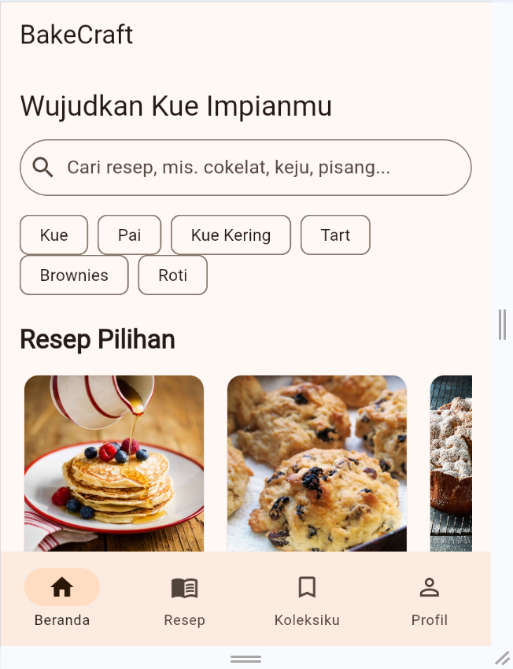
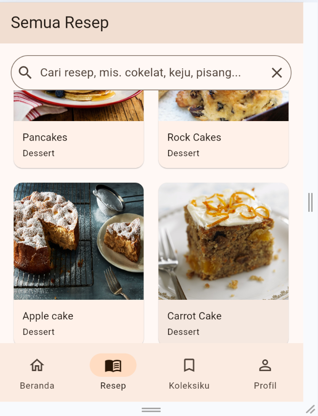
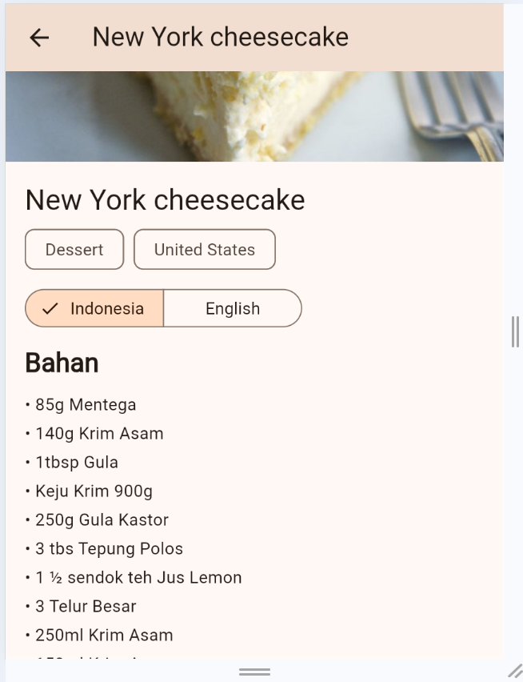
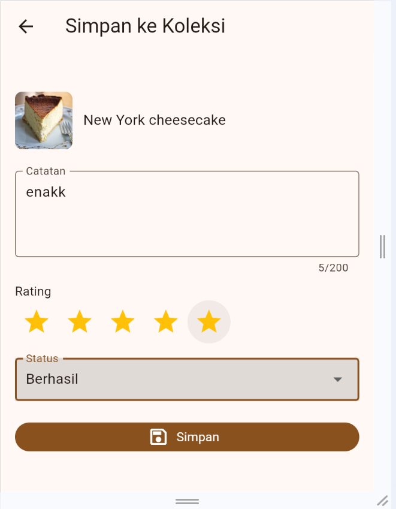
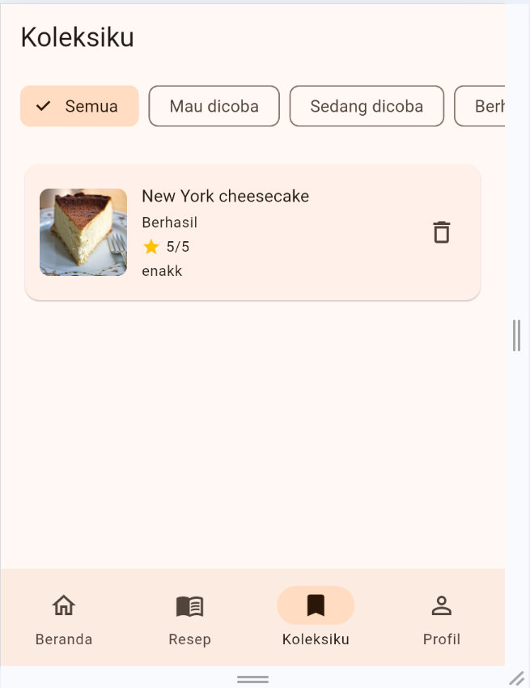
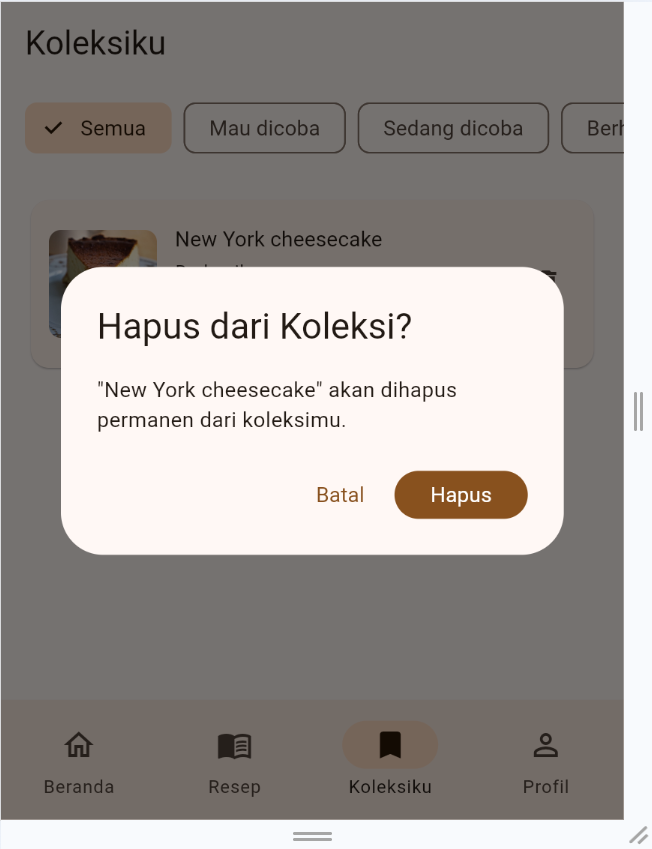

# BakeCraft

**BakeCraft** adalah aplikasi mobile Flutter untuk menjelajahi resep baking (kue, pai, kue kering, roti, dan sejenisnya) dan menyimpan resep favorit ke koleksi pribadi lengkap dengan catatan, rating, dan status percobaan. Katalog resep diambil dari REST API publik, sedangkan koleksi pribadi disimpan di database Supabase.

Project ini dibuat untuk **Project UTS Pemrograman Mobile** (individual).

| | |
|---|---|
| **Nama** | I Gusti Ayu Putu Jelantik |
| **NIM** | 2415051053 |
| **Kelas** | 5 PTI C |
| **Tema** | BakeCraft (katalog dan koleksi resep baking) |

---

## Daftar Fitur

- Beranda dengan pencarian cepat, kategori baking (Kue, Pai, Kue Kering, Tart, Brownies, Roti), dan resep pilihan
- Pencarian resep dalam bahasa Indonesia (mis. `cokelat`, `pisang`, `keju`) melalui kamus kata kunci
- Daftar resep dalam grid responsif (jumlah kolom menyesuaikan lebar layar)
- Detail resep: foto, kategori, asal, bahan, dan cara pembuatan
- **Terjemahan otomatis** bahan dan cara pembuatan ke Bahasa Indonesia, dengan tombol untuk kembali ke teks asli
- Simpan resep ke **Koleksiku** lewat form dengan validasi (catatan, rating bintang, status)
- Edit catatan, rating, dan status resep di koleksi
- Hapus resep dari koleksi dengan dialog konfirmasi
- Filter koleksi berdasarkan status: Mau dicoba, Sedang dicoba, Berhasil
- Tarik ke bawah untuk menyegarkan koleksi
- Status tombol "Sudah ada di Koleksi" yang sinkron di semua layar (shared state)
- Loading, error, dan empty state di semua layar yang memuat data
- Layout adaptif: bottom navigation bar di layar sempit, navigation rail di layar lebar
- Profil berisi identitas mahasiswa dan sumber data aplikasi

## Tech Stack

| Komponen | Teknologi |
|---|---|
| Framework | Flutter (Dart), Material 3 |
| State management | Provider + ChangeNotifier |
| HTTP client | `http` |
| Backend / database | Supabase (PostgreSQL) lewat `supabase_flutter` |
| Lokalisasi | `flutter_localizations` (locale `id`) |

## REST API yang Digunakan

| API | Fungsi | Endpoint (GET) |
|---|---|---|
| [TheMealDB](https://www.themealdb.com/api.php) | Katalog dan detail resep | `https://www.themealdb.com/api/json/v1/1/search.php?s={kata_kunci}` |
| [MyMemory](https://mymemory.translated.net/doc/spec.php) | Terjemahan otomatis EN → ID | `https://api.mymemory.translated.net/get?q={teks}&langpair=en\|id` |

Respons JSON diubah menjadi model Dart (`Recipe`). Konten resep dari TheMealDB berbahasa Inggris. Bahan dan cara pembuatan diterjemahkan otomatis oleh MyMemory, sehingga hasilnya adalah terjemahan mesin dan bisa kurang sempurna. Pemakaian anonim MyMemory dibatasi per hari, jadi email opsional dapat diisi di `env.json` untuk kuota yang lebih besar.

## Backend dan Database

Aplikasi memakai **Supabase (PostgreSQL)** untuk menyimpan koleksi pribadi. REST API dipakai untuk katalog, sedangkan database dipakai untuk data personal sehingga keduanya punya fungsi yang berbeda.

Tabel `saved_bakes`:

| Kolom | Tipe | Keterangan |
|---|---|---|
| `id` | bigint | Primary key (identity) |
| `student_id` | text | NIM pemilik data |
| `meal_id` | text | ID resep dari TheMealDB |
| `meal_name` | text | Nama resep |
| `thumbnail` | text | URL foto resep |
| `note` | text | Catatan pribadi |
| `rating` | int | 0 sampai 5 |
| `bake_status` | text | Mau dicoba / Sedang dicoba / Berhasil |
| `created_at` | timestamptz | Waktu data dibuat |

Operasi **CRUD** lengkap: Create (simpan resep), Read (daftar koleksi), Update (edit catatan, rating, status), dan Delete (hapus dengan dialog konfirmasi). Kombinasi `student_id` dan `meal_id` bersifat unik sehingga resep yang sama tidak tersimpan dua kali.

## Arsitektur Aplikasi

Alur: **UI → Provider → Repository → Service → REST API / Database**. Screen tidak melakukan HTTP atau query database secara langsung.

```
lib/
├── constants.dart
├── main.dart
├── models/
│   ├── recipe.dart
│   ├── saved_bake.dart
│   └── translated_content.dart
├── services/
│   ├── meal_api_service.dart
│   ├── translation_service.dart
│   ├── saved_bake_service.dart
│   └── keyword_translator.dart
├── repositories/
│   ├── recipe_repository.dart
│   ├── translation_repository.dart
│   └── saved_bake_repository.dart
├── providers/
│   ├── recipe_provider.dart
│   ├── translation_provider.dart
│   └── saved_bake_provider.dart
├── screens/
│   ├── app_shell.dart
│   ├── home_screen.dart
│   ├── recipe_list_screen.dart
│   ├── recipe_detail_screen.dart
│   ├── add_bake_screen.dart
│   ├── edit_bake_screen.dart
│   ├── my_bakes_screen.dart
│   └── profile_screen.dart
└── widgets/
    ├── recipe_card.dart
    ├── recipe_image.dart
    ├── section_title.dart
    ├── state_message.dart
    ├── saved_bake_tile.dart
    ├── rating_input.dart
    └── bake_form.dart
```

## Screenshot

| Beranda | Daftar Resep | Detail Resep |
|---|---|---|
|  |  |  |

| Form Simpan (Create) | Form Edit (Update) | Koleksiku (data dari database) |
|---|---|---|
|  |  |  |

| Dialog Hapus (Delete) | Layout Lebar (Responsif) | Data di Supabase |
|---|---|---|
|  |  |  |

## Cara Menjalankan Project

**Prasyarat:** Flutter SDK, Git, dan akun [Supabase](https://supabase.com) (gratis).

1. **Clone repository**
   ```bash
   git clone https://github.com/ayujelantik801-commits/UTS_2415051053_I_Gusti_Ayu_Putu_Jelantik.git
   cd UTS_2415051053_I_Gusti_Ayu_Putu_Jelantik
   ```

2. **Buat project Supabase**, lalu jalankan SQL berikut di **SQL Editor**:
   ```sql
   create table public.saved_bakes (
     id bigint primary key generated always as identity,
     student_id text not null,
     meal_id text not null,
     meal_name text not null,
     thumbnail text,
     note text,
     rating int not null default 0 check (rating between 0 and 5),
     bake_status text not null default 'Mau dicoba'
       check (bake_status in ('Mau dicoba', 'Sedang dicoba', 'Berhasil')),
     created_at timestamptz not null default now(),
     constraint saved_bakes_student_meal_unique unique (student_id, meal_id)
   );

   alter table public.saved_bakes enable row level security;

   grant select, insert, update, delete on public.saved_bakes to anon;

   create policy "anon boleh membaca" on public.saved_bakes
     for select to anon using (true);
   create policy "anon boleh menambah" on public.saved_bakes
     for insert to anon with check (true);
   create policy "anon boleh mengubah" on public.saved_bakes
     for update to anon using (true) with check (true);
   create policy "anon boleh menghapus" on public.saved_bakes
     for delete to anon using (true);
   ```

3. **Siapkan konfigurasi.** Salin `env.example.json` menjadi `env.json`, lalu isi dengan **Project URL** dan **Publishable key** dari Supabase (Project Settings → API Keys):
   ```json
   {
     "SUPABASE_URL": "https://your-project-ref.supabase.co",
     "SUPABASE_KEY": "your-publishable-key",
     "MYMEMORY_EMAIL": "your-email@example.com"
   }
   ```
   `MYMEMORY_EMAIL` bersifat opsional (untuk menaikkan kuota terjemahan harian).

4. **Pasang dependensi**
   ```bash
   flutter pub get
   ```

5. **Jalankan aplikasi**
   ```bash
   flutter run --dart-define-from-file=env.json
   ```

6. **Build APK (opsional)**
   ```bash
   flutter build apk --release --dart-define-from-file=env.json
   ```

> Di Windows, Developer Mode perlu diaktifkan (`start ms-settings:developers`) karena plugin Flutter membutuhkan dukungan symlink. Untuk tampilan foto yang lengkap, jalankan di Android atau desktop, karena di browser sebagian foto dapat diblokir kebijakan CORS.

## Keamanan

- File `env.json` masuk `.gitignore` dan tidak pernah di-commit. Yang di-commit hanya `env.example.json`.
- Aplikasi hanya memakai **publishable key** Supabase yang dilindungi Row Level Security. Key `secret` atau `service_role` tidak dipakai dan tidak disimpan di repository.
- Karena aplikasi tidak memiliki fitur login, policy RLS dibuka untuk peran `anon`. Untuk aplikasi produksi, policy sebaiknya dibatasi per pengguna menggunakan Supabase Auth.

## Sumber Data

Resep: [TheMealDB](https://www.themealdb.com). Terjemahan: [MyMemory](https://mymemory.translated.net). Penyimpanan koleksi: [Supabase](https://supabase.com).